# 农业电商服务系统30249--论文

> 🎓 **计算机毕业设计 · 农业电商服务系统30249--论文**
>
> 本仓库只放**项目介绍 + 运行截图**（截图是站点带水印的原图，存在仓库 `images/` 里）。
>
> 👉 **完整可运行源码 / 数据库脚本 / 部署文档：[点我获取](https://geekcode.top/archives/%E5%86%9C%E4%B8%9A%E7%94%B5%E5%95%86%E6%9C%8D%E5%8A%A1%E7%B3%BB%E7%BB%9F30249-%E8%AE%BA%E6%96%87?utm_source=github)**
>
> 💬 咨询微信：**ir9372**　|　🌐 更多项目：[极客代码 geekcode.top](https://geekcode.top/?utm_source=github)
>
> 📌 项目详情页：<https://geekcode.top/archives/%E5%86%9C%E4%B8%9A%E7%94%B5%E5%95%86%E6%9C%8D%E5%8A%A1%E7%B3%BB%E7%BB%9F30249-%E8%AE%BA%E6%96%87?utm_source=github>

<table><td width="230" align="center"> <b>扫码加微信 ir9372</b></td><td valign="middle">📦 源码 = 项目介绍 + 全部运行截图 + 数据库 + 部署文档 👉 点上方任意截图，直接跳到 <b>极客代码 geekcode.top</b> 详情页</td></table>

---

<h1>农业电商服务系统_30249--论文</h1>
<h2>项目概述</h2>

本项目名为“农业电商服务系统”，旨在构建一个集农产品销售、助农信息发布及监督管理于一体的综合性电子商务平台。系统采用前后端分离架构，面向农户、商家及普通消费者，解决传统农产品流通渠道单一、信息不对称及监管缺失等问题。核心功能涵盖商品展示与交易、购物车管理、订单处理、会员账户体系、助农资讯发布以及农产品质量监督等模块。技术栈基于 Java Spring Boot 生态，结合 MyBatis-Plus 进行数据持久化操作，使用 Druid 作为数据库连接池，前端通过 Vue 框架实现交互界面，并配套微信小程序端以提供移动端便捷服务。该系统适用于农村电商服务站、农产品合作社及地方农业管理部门，致力于提升农产品上行效率，促进乡村振兴数字化发展。

<h2>技术架构</h2>
<h3>后端架构</h3>

后端服务基于 Java 语言开发，采用分层架构设计，主要依赖以下核心技术组件：

<ul>
<li><strong>Spring Framework</strong>: 包含 <code>spring-core</code>, <code>spring-context</code>, <code>spring-web</code>, <code>spring-webmvc</code> 等模块，负责业务逻辑控制、依赖注入及 RESTful API 接口暴露。</li>
<li><strong>MyBatis-Plus</strong>: 作为 ORM（对象关系映射）框架，简化了数据库 CRUD 操作，提供了高效的数据访问层支持。</li>
<li><strong>Druid</strong>: 阿里巴巴开源的高性能数据库连接池，用于监控数据库连接状态、SQL 执行情况及防止 SQL 注入攻击，保障系统稳定性。</li>
<li><strong>Controller 层</strong>: 定义了多个控制器类（如 <code>OrdersController</code>, <code>ShangjiaController</code>, <code>HuiyuanController</code> 等），分别处理订单、商家、会员、评论、地址等业务请求。</li>
</ul>
<h3>前端架构</h3>

前端采用 <code>vue-integrated</code> 集成模式，分为 Web 管理后台和微信小程序两部分：

<ul>
<li><strong>Web 管理后台</strong>: 基于 Vue.js 框架构建，通过路由配置（如 <code>/shangpinxinxi</code>, <code>/huiyuan</code>）实现页面跳转，主要用于管理员对系统数据进行维护和管理。</li>
<li><strong>微信小程序</strong>: 面向终端用户，提供首页浏览、商品详情、购物车、个人中心、订单管理及支付确认等功能，利用小程序原生能力实现轻量级应用体验。</li>
</ul>
<h3>数据库设计要点</h3>

虽然未提供具体表结构截图，但根据 Controller 列表和功能模块推断，数据库需支撑以下核心实体关系：

<ol>
<li><strong>用户域</strong>: 会员 (<code>Huiyuan</code>)、收货地址 (<code>Address</code>)。</li>
<li><strong>商品域</strong>: 商品信息 (<code>Shangpinxinxi</code>)、商品分类 (<code>Shangpinfenlei</code>)、商家 (<code>Shangjia</code>)。</li>
<li><strong>交易域</strong>: 购物车 (<code>Cart</code>)、订单 (<code>Orders</code>)。</li>
<li><strong>内容与服务域</strong>: 新闻/公告 (<code>News</code>)、助农信息 (<code>Zhunongxinxi</code>)、留言板 (<code>Messages</code>)、商品评论 (<code>Discussshangpinxinxi</code>)、农产品监督 (<code>Nongchanpinjiandu</code>)。</li>
<li><strong>系统配置</strong>: 全局配置 (<code>Config</code>)。</li>
</ol>
<h2>功能模块</h2>
<h3>前台用户端（微信小程序）</h3>

该模块主要服务于普通消费者和注册会员，提供便捷的购物体验和信息获取渠道：

<ul>
<li><strong>基础服务</strong>:</li>
<li><strong>登录/注册</strong>: 支持用户身份认证与账号创建。</li>
<li><strong>个人信息</strong>: 查看及修改个人资料。</li>
<li><strong>账户充值</strong>: 支持余额充值及支付确认流程 (<code>payconfirm</code>)。</li>
<li><strong>商品浏览与购买</strong>:</li>
<li><strong>首页</strong>: 展示推荐商品或轮播图。</li>
<li><strong>商品信息</strong>: 浏览商品详情页，查看参数与描述。</li>
<li><strong>购物车</strong>: 添加商品至购物车，进行数量调整与结算。</li>
<li><strong>确认订单</strong>: 选择收货地址，确认订单信息并提交。</li>
<li><strong>订单管理</strong>:</li>
<li><strong>我的订单</strong>: 查看历史订单状态。</li>
<li><strong>物流跟踪</strong>: 查看订单物流详情 (<code>logistics</code>)。</li>
<li><strong>收货地址</strong>: 管理常用收货地址及新增/编辑地址详情。</li>
<li><strong>互动与信息</strong>:</li>
<li><strong>留言板</strong>: 参与社区讨论或留言反馈。</li>
<li><strong>公告信息</strong>: 查看平台发布的最新通知。</li>
<li><strong>农产品监督</strong>: 查看农产品质量监管相关信息列表。</li>
</ul>
<h3>后台管理端（Web Admin）</h3>

该模块主要服务于系统管理员，用于全面管控平台运营数据：

<ul>
<li><strong>系统首页</strong>: 概览平台关键数据统计。</li>
<li><strong>商品管理</strong>:</li>
<li><strong>商品信息</strong>: 增删改查商品详情，上下架管理。</li>
<li><strong>商品分类</strong>: 维护商品类目结构。</li>
<li><strong>商品评论</strong>: 审核与管理用户对商品的评论信息。</li>
<li><strong>用户与商家管理</strong>:</li>
<li><strong>会员管理</strong>: 查看注册用户列表，管理会员状态。</li>
<li><strong>商家管理</strong>: 审核入驻商家资质，管理商家信息。</li>
<li><strong>订单管理</strong>:</li>
<li><strong>订单列表</strong>: 查看所有订单状态（待支付、已发货等），处理售后需求。</li>
<li><strong>内容与资讯管理</strong>:</li>
<li><strong>公告信息 (News)</strong>: 发布平台公告。</li>
<li><strong>助农信息</strong>: 发布助农政策、技术指导等相关资讯。</li>
<li><strong>留言板</strong>: 查看并回复用户留言。</li>
<li><strong>农产品监督</strong>: 录入和管理农产品质量安全监督记录。</li>
<li><strong>系统配置</strong>:</li>
<li><strong>参数配置</strong>: 管理系统基本运行参数。</li>
</ul>
<h2>用户角色与权限</h2>

根据系统功能划分，主要存在以下两类角色：

<ol>
<li><strong>普通用户（会员）</strong></li>
</ol>
<ul>
<li><strong>权限范围</strong>: 仅限微信小程序端操作。</li>
<li><strong>核心功能</strong>: 注册登录、浏览商品、加入购物车、下单支付、查询订单物流、管理收货地址、发表商品评论、参与留言板互动、查看公告及助农信息、查询农产品监督结果、账户充值。</li>
<li><strong>限制</strong>: 无法访问后台管理界面，无法修改其他用户数据或系统配置。</li>
</ul>
<ol start="2">
<li><strong>系统管理员</strong></li>
</ol>
<ul>
<li><strong>权限范围</strong>: 拥有 Web 后台管理系统的最高权限。</li>
<li><strong>核心功能</strong>: </li>
<li><strong>全量数据管理</strong>: 对商品、分类、商家、会员、订单、评论、新闻、助农信息、留言、监督记录等进行增删改查。</li>
<li><strong>系统运维</strong>: 配置系统参数，监控系统运行状态。</li>
<li><strong>审核职能</strong>: 审核商家入驻申请、处理异常订单、筛选违规评论等。</li>
<li><strong>限制</strong>: 通常不直接参与前台购物流程，专注于平台运营与维护。</li>
</ul>

<em>(注：商家角色在后台有独立的管理入口 <code>/shangjia</code>，但在现有截图中未明确展示商家独立的登录门户，推测商家可能由管理员代为录入或由特定子账号管理，具体权限细节依据后台菜单可见性为准。)</em>

<h2>项目特色与创新点</h2>
<ol>
<li>
<strong>“电商+助农”双轨驱动模式</strong>
   不同于纯商业电商平台，本系统在核心交易链路之外，专门设计了“助农信息”模块 (<code>/zhunongxinxi</code>)。这不仅促进了农产品的销售转化，还承担了农业技术推广和政策宣导的社会责任，体现了数字乡村建设的实际应用价值。

</li>
<li>
<strong>全流程质量追溯与监督机制</strong>
   引入“农产品监督” (<code>nongchanpinjiandu</code>) 模块，允许管理员录入或展示农产品质量检测与监管信息。这一功能增强了消费者对平台农产品的信任度，解决了生鲜电商中常见的食品安全痛点，构建了从田间到餐桌的信任闭环。

</li>
<li>
<strong>多端协同的用户体验</strong>
   采用 Web 后台管理与微信小程序前台相结合的技术方案。后台侧重于复杂的数据治理与运营决策，小程序侧重于轻量化、高频次的用户触达与即时交易。这种组合既保证了管理的高效性，又契合了下沉市场用户的使用习惯。

</li>
<li>
<strong>标准化的社区互动体系</strong>
   集成了留言板 (<code>messages</code>) 和商品评论 (<code>discussshangpinxinxi</code>) 功能，形成了双向互动的社区氛围。用户可以通过留言反馈问题，通过评论分享购买体验，为后续用户提供参考，同时也为平台优化选品和服务提供数据支撑。

</li>
</ol>
<h2>部署环境</h2>

为确保系统正常运行，需准备以下软硬件环境：

<h3>硬件环境</h3>
<ul>
<li><strong>服务器</strong>: CPU 4核及以上，内存 8GB 及以上，硬盘空间 50GB 以上（建议 SSD）。</li>
<li><strong>网络</strong>: 稳定的互联网连接，开放必要端口（如 80, 443, 8080 等）。</li>
</ul>
<h3>软件环境</h3>
<ul>
<li><strong>操作系统</strong>: Windows Server / Linux (CentOS/Ubuntu) / macOS。</li>
<li><strong>Java 环境</strong>: JDK 1.8 或更高版本（兼容 Spring Boot 要求）。</li>
<li><strong>数据库</strong>: MySQL 5.7 或 8.0 版本，需配置 UTF-8 字符集以支持中文存储。</li>
<li><strong>构建工具</strong>: Maven 3.6+（用于后端项目编译打包）。</li>
<li><strong>Node.js</strong>: v14.x 或 v16.x 版本（用于前端 Vue 项目的依赖安装与构建）。</li>
<li><strong>微信开发者工具</strong>: 最新版本（用于微信小程序端的代码调试、预览及上传发布）。</li>
<li><strong>浏览器</strong>: Chrome, Edge, Firefox 等主流现代浏览器（用于访问后台管理系统）。</li>
</ul>
<h2>五、技术特性</h2>
<ul>
<li>前后端集成部署，前端资源打包至后端 static 目录</li>
<li>使用 MyBatis-Plus 简化数据访问层开发</li>
</ul>
<h2>六、功能模块截图</h2>
<h3>前台用户端</h3>
<h4>前台首页框架</h4>

<h3>微信小程序用户端</h3>

<figure><figcaption>小程序-登录</figcaption></figure>
<figure><figcaption>小程序-个人信息</figcaption></figure>
<figure><figcaption>小程序-公告信息列表</figcaption></figure>
<figure><a href="https://geekcode.top/archives/%E5%86%9C%E4%B8%9A%E7%94%B5%E5%95%86%E6%9C%8D%E5%8A%A1%E7%B3%BB%E7%BB%9F30249-%E8%AE%BA%E6%96%87?utm_source=github" title="查看完整源码">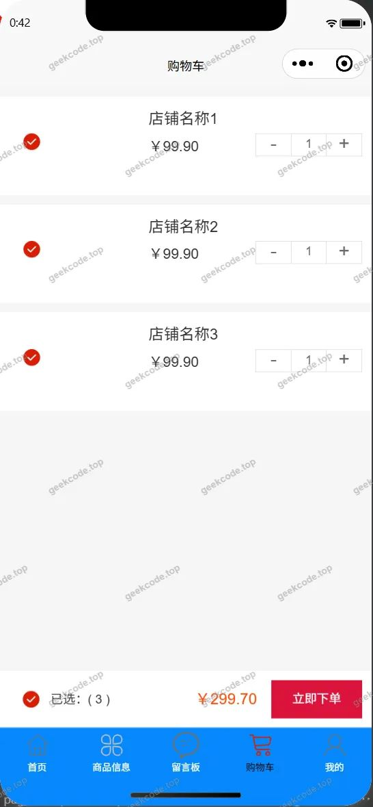</a><figcaption>小程序-购物车</figcaption></figure>
<figure><figcaption>小程序-留言板</figcaption></figure>
<figure><a href="https://geekcode.top/archives/%E5%86%9C%E4%B8%9A%E7%94%B5%E5%95%86%E6%9C%8D%E5%8A%A1%E7%B3%BB%E7%BB%9F30249-%E8%AE%BA%E6%96%87?utm_source=github" title="查看完整源码">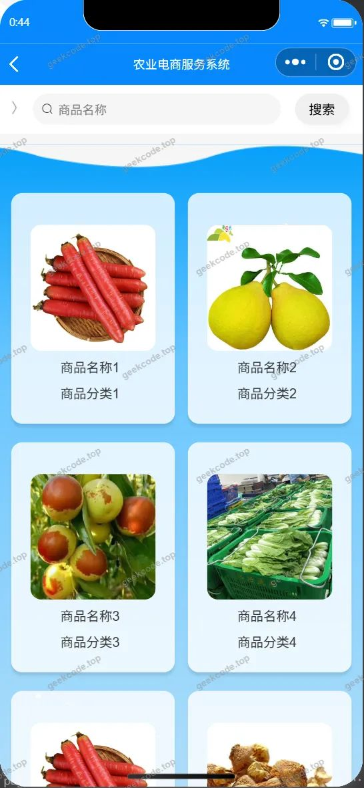</a><figcaption>小程序-农产品监督列表</figcaption></figure>
<figure><a href="https://geekcode.top/archives/%E5%86%9C%E4%B8%9A%E7%94%B5%E5%95%86%E6%9C%8D%E5%8A%A1%E7%B3%BB%E7%BB%9F30249-%E8%AE%BA%E6%96%87?utm_source=github" title="查看完整源码">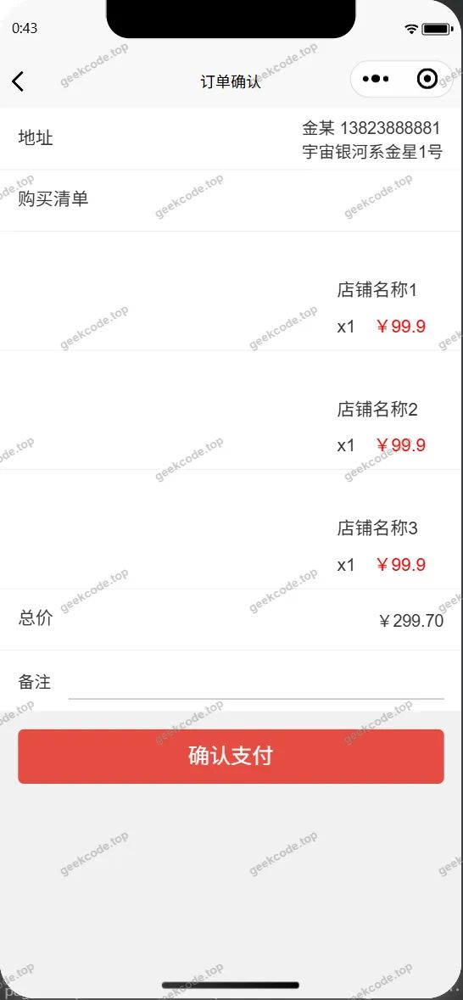</a><figcaption>小程序-确认订单</figcaption></figure>
<figure><figcaption>小程序-商品信息</figcaption></figure>
<figure><figcaption>小程序-收货地址</figcaption></figure>
<figure><figcaption>小程序-收货地址详情</figcaption></figure>
<figure><figcaption>小程序-首页</figcaption></figure>
<figure><a href="https://geekcode.top/archives/%E5%86%9C%E4%B8%9A%E7%94%B5%E5%95%86%E6%9C%8D%E5%8A%A1%E7%B3%BB%E7%BB%9F30249-%E8%AE%BA%E6%96%87?utm_source=github" title="查看完整源码">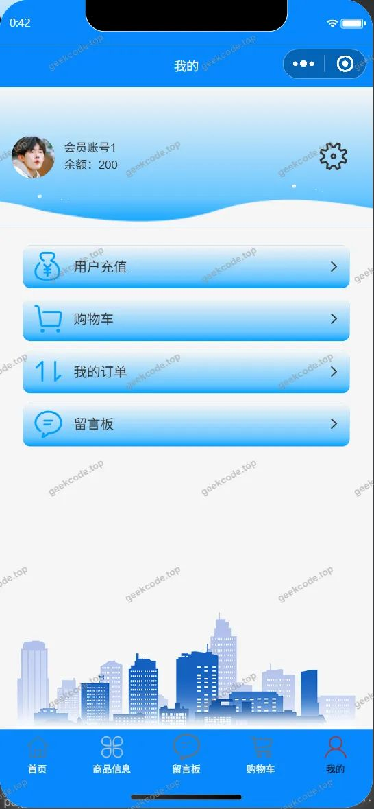</a><figcaption>小程序-我的</figcaption></figure>
<figure><figcaption>小程序-我的订单</figcaption></figure>
<figure><figcaption>小程序-我的订单logistics</figcaption></figure>
<figure><a href="https://geekcode.top/archives/%E5%86%9C%E4%B8%9A%E7%94%B5%E5%95%86%E6%9C%8D%E5%8A%A1%E7%B3%BB%E7%BB%9F30249-%E8%AE%BA%E6%96%87?utm_source=github" title="查看完整源码">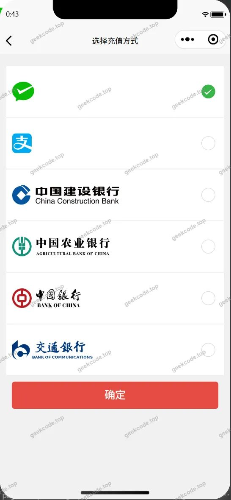</a><figcaption>小程序-账户充值payconfirm</figcaption></figure>
<figure><a href="https://geekcode.top/archives/%E5%86%9C%E4%B8%9A%E7%94%B5%E5%95%86%E6%9C%8D%E5%8A%A1%E7%B3%BB%E7%BB%9F30249-%E8%AE%BA%E6%96%87?utm_source=github" title="查看完整源码">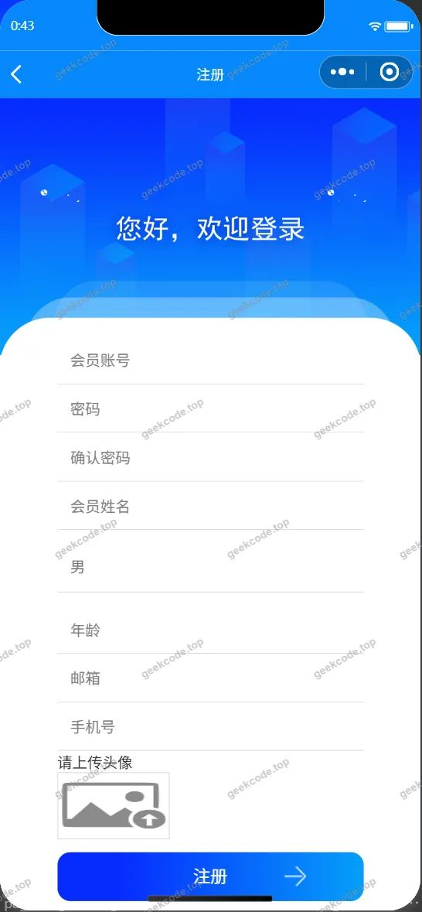</a><figcaption>小程序-注册</figcaption></figure>

<h3>微信小程序管理端</h3>

<figure><figcaption>小程序-管理端-会员列表</figcaption></figure>
<figure><figcaption>小程序-管理端-商家列表</figcaption></figure>
<figure><figcaption>小程序-管理端-商品分类列表</figcaption></figure>
<figure><figcaption>小程序-管理端-助农信息列表</figcaption></figure>

<h3>后台管理端</h3>
<h4>后台-登录页</h4>

<h4>后台-公告信息</h4>

<a href="https://geekcode.top/archives/%E5%86%9C%E4%B8%9A%E7%94%B5%E5%95%86%E6%9C%8D%E5%8A%A1%E7%B3%BB%E7%BB%9F30249-%E8%AE%BA%E6%96%87?utm_source=github" title="查看完整源码">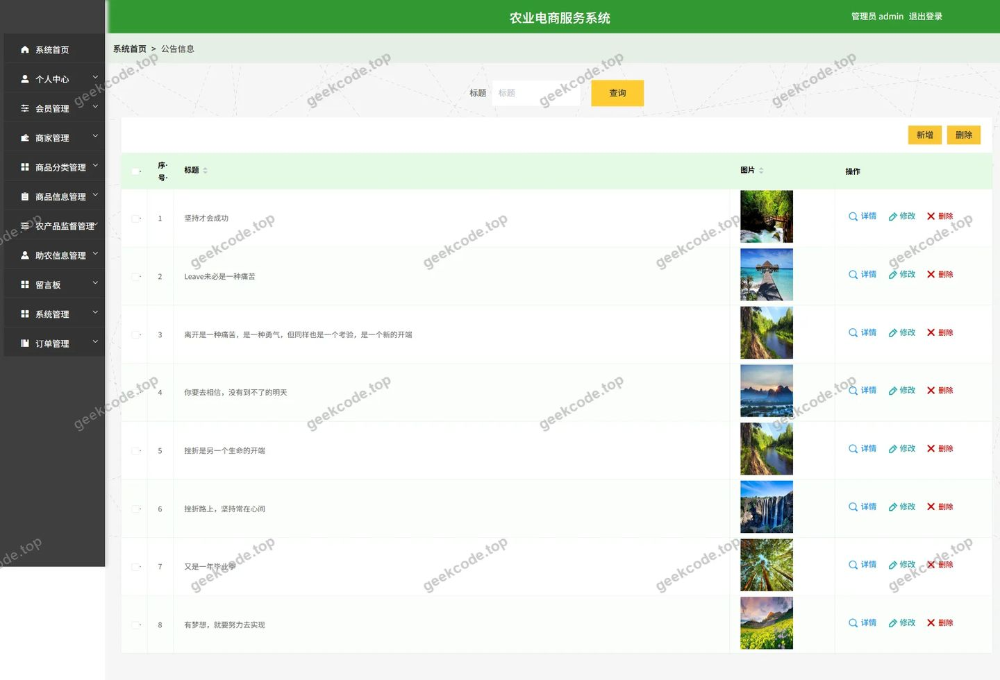</a>

<h4>后台-留言板</h4>

<a href="https://geekcode.top/archives/%E5%86%9C%E4%B8%9A%E7%94%B5%E5%95%86%E6%9C%8D%E5%8A%A1%E7%B3%BB%E7%BB%9F30249-%E8%AE%BA%E6%96%87?utm_source=github" title="查看完整源码">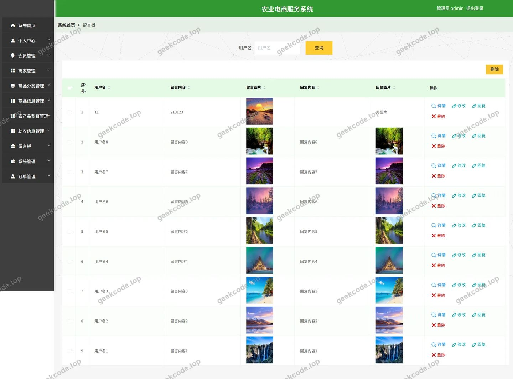</a>

<h4>后台-商品分类</h4>

<a href="https://geekcode.top/archives/%E5%86%9C%E4%B8%9A%E7%94%B5%E5%95%86%E6%9C%8D%E5%8A%A1%E7%B3%BB%E7%BB%9F30249-%E8%AE%BA%E6%96%87?utm_source=github" title="查看完整源码">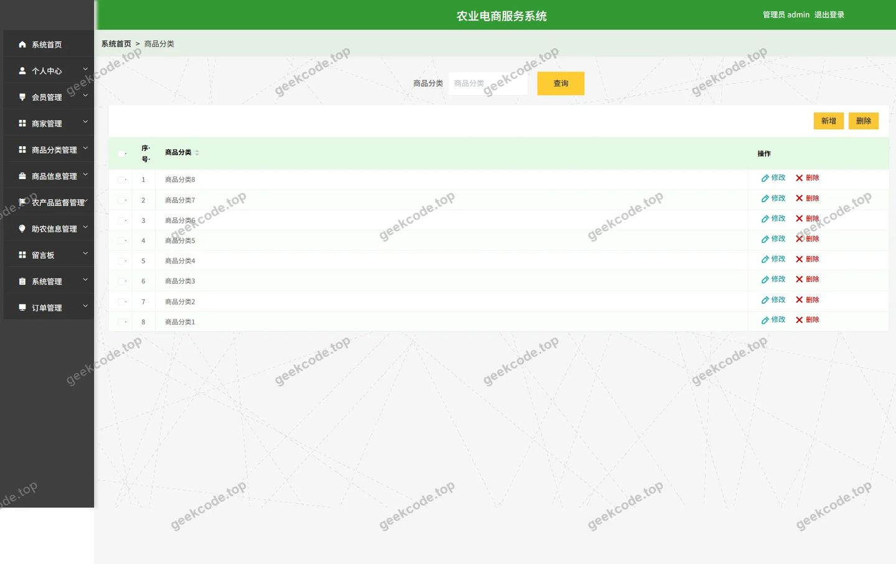</a>

<h4>后台-商品信息</h4>

<a href="https://geekcode.top/archives/%E5%86%9C%E4%B8%9A%E7%94%B5%E5%95%86%E6%9C%8D%E5%8A%A1%E7%B3%BB%E7%BB%9F30249-%E8%AE%BA%E6%96%87?utm_source=github" title="查看完整源码">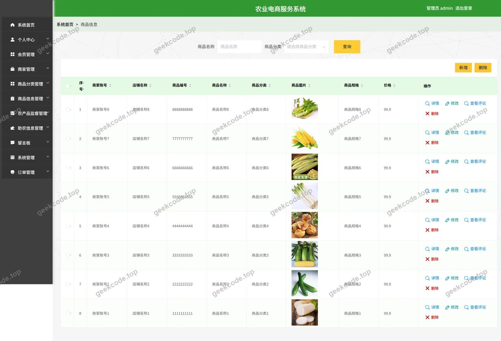</a>

<h4>后台-商品信息评论</h4>

<a href="https://geekcode.top/archives/%E5%86%9C%E4%B8%9A%E7%94%B5%E5%95%86%E6%9C%8D%E5%8A%A1%E7%B3%BB%E7%BB%9F30249-%E8%AE%BA%E6%96%87?utm_source=github" title="查看完整源码">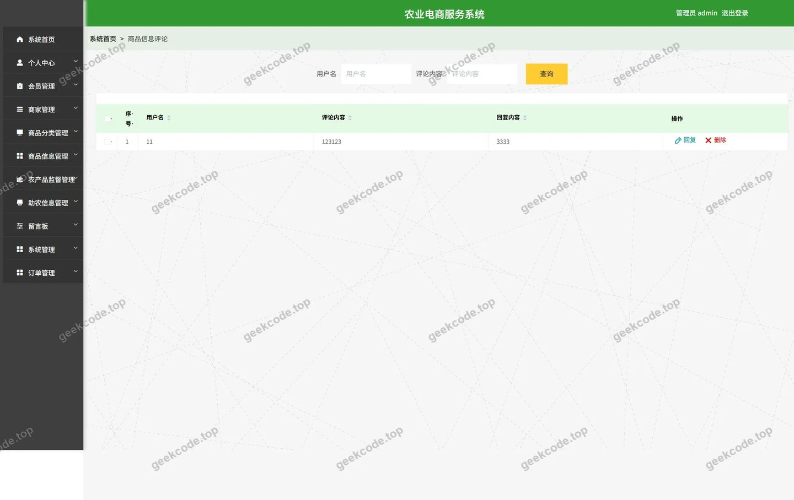</a>

<h4>后台首页</h4>

<a href="https://geekcode.top/archives/%E5%86%9C%E4%B8%9A%E7%94%B5%E5%95%86%E6%9C%8D%E5%8A%A1%E7%B3%BB%E7%BB%9F30249-%E8%AE%BA%E6%96%87?utm_source=github" title="查看完整源码">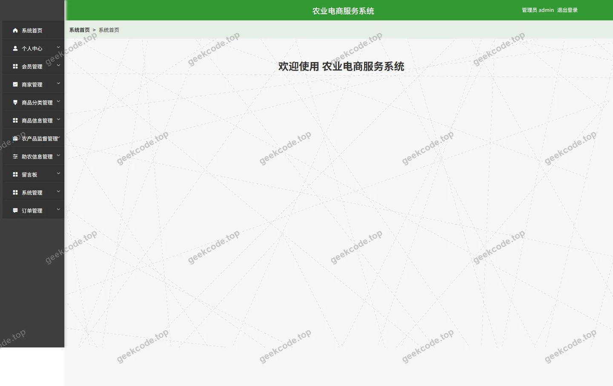</a>

<h4>后台-助农信息</h4>

<a href="https://geekcode.top/archives/%E5%86%9C%E4%B8%9A%E7%94%B5%E5%95%86%E6%9C%8D%E5%8A%A1%E7%B3%BB%E7%BB%9F30249-%E8%AE%BA%E6%96%87?utm_source=github" title="查看完整源码">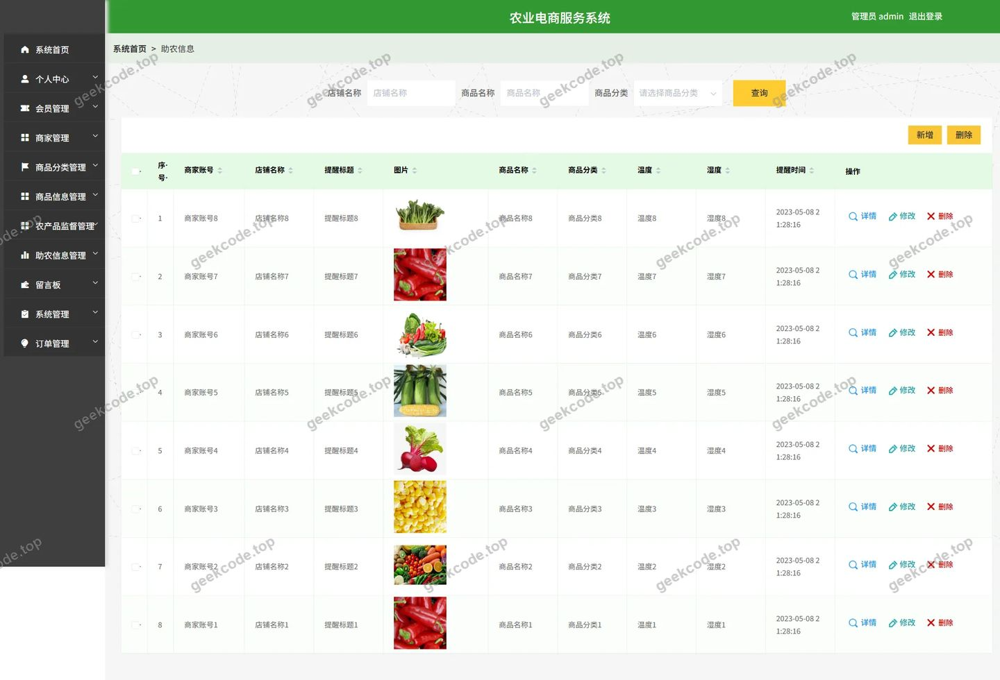</a>

---

## 获取完整源码

| 项目 | 说明 |
| --- | --- |
| 项目名 | 农业电商服务系统30249--论文 |
| 运行截图 | 本文 29 张（站点带水印原图，仓库 `images/` 目录） |
| 完整源码 | [https://geekcode.top/archives/%E5%86%9C%E4%B8%9A%E7%94%B5%E5%95%86%E6%9C%8D%E5%8A%A1%E7%B3%BB%E7%BB%9F30249-%E8%AE%BA%E6%96%87?utm_source=github](https://geekcode.top/archives/%E5%86%9C%E4%B8%9A%E7%94%B5%E5%95%86%E6%9C%8D%E5%8A%A1%E7%B3%BB%E7%BB%9F30249-%E8%AE%BA%E6%96%87?utm_source=github) |
| 咨询微信 | **ir9372**（备注：jingpin-yuanma） |
| 更多项目 | [极客代码 geekcode.top](https://geekcode.top/?utm_source=github) |

> 需要源码、部署、改配置、跑不起来等问题，加微信 ir9372 沟通，说明项目名即可。
